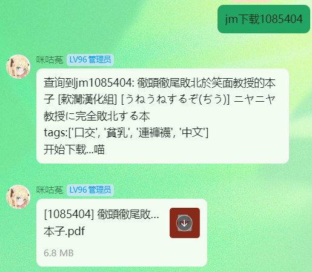

<div align="center">
    <a href="https://v2.nonebot.dev/store">
    </a>

## ✨ *基于 Nonebot2 的 JMComic 插件* ✨

[](./LICENSE)
[](https://www.python.org)
[](#适配器支持)
<br/>

[](https://github.com/astral-sh/uv)
[](https://github.com/astral-sh/ruff)

</div>

## 📖 介绍

JMComic 搜索、下载插件，支持全局屏蔽 jm 号和 tag，通过 Alconna 通用消息支持多个平台；OneBot V11 保留群文件夹上传能力。

## 适配器支持

插件使用 `inherit_supported_adapters()` 继承 [Alconna](https://github.com/nonebot/plugin-alconna) 与 [Uninfo](https://github.com/RF-Tar-Railt/nonebot-plugin-uninfo) 共同支持的适配器，包括 OneBot V11、Telegram 和 Discord。宿主需要自行安装并配置对应适配器。

| 能力 | OneBot V11 | Telegram、Discord 等平台 |
| --- | --- | --- |
| 查询、搜索与翻页 | 合并转发 | 支持合并转发时使用，否则逐条发送结果 |
| PDF/ZIP 下载 | 群文件或私聊文件上传 | 通过 Alconna 发送文件，受平台文件类型、大小及权限限制 |
| 指定上传文件夹 | 支持，取决于协议端 API | 不支持，命令会提示 |
| 群组/频道开关与黑名单 | 支持 | 通过 Uninfo 获取场景和成员权限 |
| 违规下载惩罚 | 普通成员加入黑名单，并尝试禁言 24 小时 | 普通成员加入当前场景黑名单，不调用 QQ 禁言 API |

其他适配器的图片、文件和撤回能力以 Alconna 的[支持列表](https://github.com/nonebot/plugin-alconna#支持情况)为准；平台不支持文件发送或上传失败时，不扣除下载次数。搜索进度消息仅在支持撤回时尝试撤回，撤回失败不会影响结果。

群组/频道配置、用户下载额度按平台隔离；搜索翻页还按机器人和会话场景隔离。原有 OneBot V11 群号和用户 ID 数据继续沿用，无需迁移。跨平台管理权限依赖 Uninfo，无法确认目标权限时取消黑名单操作；无法识别角色的用户只会被阻止下载违规内容，不会自动加入黑名单。

`jm启用群`、`jm禁用群` 的 ID 属于发出命令的平台；负数群号可直接填写，频道或话题使用 `父场景ID/场景ID`。也可由超级用户在目标场景发送 `开启jm`。请按 NoneBot 的平台前缀规则配置 `SUPERUSERS`，避免不同平台的同号用户共享超级用户权限。

`jm拉黑`、`jm解除拉黑` 接受用户提及或用户 ID。Telegram 的普通 `@username` 不一定携带用户 ID，无法解析时请直接填写数字用户 ID；插件不会把用户名当作用户 ID 保存。

## 💿 安装

<details open>
<summary>使用 nb-cli 安装</summary>
在 NoneBot2 项目的根目录下打开命令行，输入以下指令即可安装

```bash
nb plugin install nonebot-plugin-jmdownloader --upgrade
```
使用 **pypi** 源安装

```bash
nb plugin install nonebot-plugin-jmdownloader --upgrade -i "https://pypi.org/simple"
```
使用**清华源**安装

```bash
nb plugin install nonebot-plugin-jmdownloader --upgrade -i "https://pypi.tuna.tsinghua.edu.cn/simple"
```
</details>

<details>

<summary>使用包管理器安装</summary>
在 NoneBot2 项目的插件目录下，打开命令行，根据你使用的包管理器，输入相应的安装命令

<details open>
<summary>uv</summary>

```bash
uv add nonebot-plugin-jmdownloader
```
安装仓库 main 分支

```bash
uv add git+https://github.com/Misty02600/nonebot-plugin-jmdownloader@main
```
</details>

<details>
<summary>pdm</summary>

```bash
pdm add nonebot-plugin-jmdownloader
```
安装仓库 main 分支

```bash
pdm add git+https://github.com/Misty02600/nonebot-plugin-jmdownloader@main
```
</details>

<details>
<summary>poetry</summary>

```bash
poetry add nonebot-plugin-jmdownloader
```
安装仓库 main 分支

```bash
poetry add git+https://github.com/Misty02600/nonebot-plugin-jmdownloader@main
```
</details>

打开 NoneBot2 项目根目录下的 `pyproject.toml` 文件，在 `[tool.nonebot]` 部分追加写入

```toml
plugins = ["nonebot_plugin_jmdownloader"]
```

</details>

## ⚙️ 配置

插件使用[nonebot_plugin_localstore](https://github.com/nonebot/plugin-localstore)储存数据和下载缓存。

在 NoneBot2 项目的`.env`文件中添加下表中的必填配置

|            配置项            | 必填  |  默认值   |                      说明                      |
| :--------------------------: | :---: | :-------: | :--------------------------------------------: |
|       jmcomic_username       |  否   |    无     |                  JM登录用户名                  |
|       jmcomic_password       |  否   |    无     |                   JM登录密码                   |
|       jmcomic_proxies        |  否   |  system   |                  网络代理地址                  |
|         jmcomic_log          |  否   |   False   |    是否开启JMComic-Crawler-Python的日志输出    |
|     jmcomic_thread_count     |  否   |    10     |                  下载线程数量                  |
|   jmcomic_group_list_mode    |  否   | blacklist |        群列表模式：blacklist/whitelist         |
|     jmcomic_allow_groups     |  否   |    无     |     已废弃，请使用 jmcomic_group_list_mode     |
|    jmcomic_allow_private     |  否   |   True    |              是否允许私聊使用功能              |
|     jmcomic_user_limits      |  否   |     5     |           每位用户的每周下载限制次数           |
|    jmcomic_output_format     |  否   |    pdf    |              输出格式：pdf 或 zip              |
|     jmcomic_zip_password     |  否   |    无     | ZIP 密码模板，留空不设置密码，{id}会替换为jm号 |
|     jmcomic_pdf_password     |  否   |    无     | PDF 密码模板，留空不设置密码，{id}会替换为jm号 |
|   jmcomic_modify_real_md5    |  否   |   False   |    修改PDF的MD5以避免发送失败（仅PDF有效）     |
|   jmcomic_results_per_page   |  否   |    20     |             每页显示的搜索结果数量             |
|    jmcomic_max_page_count    |  否   |    150    |       单次下载最大页数限制，0表示不限制        |
| jmcomic_allow_album_download |  否   |   False   |       是否允许使用本子集(多章节)下载功能       |
| jmcomic_punish_on_violation  |  否   |   True    |    群员下载违规内容时是否惩罚（禁言+拉黑）     |

**群列表模式说明：**
- `blacklist`（黑名单模式）：默认禁用所有群，只有显式启用的群才能使用
- `whitelist`（白名单模式）：默认启用所有群，只有显式禁用的群不能使用


**示例：**
```yaml
# 是否启用 JMComic 日志 (True 表示启用, False 表示禁用)
JMCOMIC_LOG=True
# JMComic 代理配置，更多格式参考https://jmcomic.readthedocs.io/zh-cn/latest/option_file_syntax
JMCOMIC_PROXIES=127.0.0.1:10809
# 下载线程数量 (线程越多对性能要求越高，范围 1~50)
JMCOMIC_THREAD_COUNT=10
# JMComic 登录用户名，如果不填则不登录，不登录时部分本子可能会受限
JMCOMIC_USERNAME=******
# JMComic 登录密码
JMCOMIC_PASSWORD=******
# JMComic 群列表模式：blacklist（默认禁用）/ whitelist（默认启用）
JMCOMIC_GROUP_LIST_MODE=blacklist
# [废弃] 旧配置，使用 True = whitelist, False = blacklist
# JMCOMIC_ALLOW_GROUPS=False
# JMComic 是否允许私聊使用功能
JMCOMIC_ALLOW_PRIVATE=True
# JMComic 每位用户的每周下载限制次数
JMCOMIC_USER_LIMITS=5
# JMComic 输出格式：pdf 或 zip
JMCOMIC_OUTPUT_FORMAT=pdf
# JMComic ZIP 压缩包密码，仅 zip 格式有效，未配置或留空则不加密，"{id}"会被替换为jm号
# JMCOMIC_ZIP_PASSWORD=your_password
# JMComic PDF 密码，仅 pdf 格式有效，未配置或留空则不加密，"{id}"会被替换为jm号
# JMCOMIC_PDF_PASSWORD={id}
# JMComic 是否修改PDF文件的MD5值（增强防和谐但可能增加流量消耗，仅PDF格式有效）
JMCOMIC_MODIFY_REAL_MD5=False
# 每页显示的搜索结果数量，越多每次发送时间越长且越容易被吞，建议40以内
JMCOMIC_RESULTS_PER_PAGE=20
# 单次下载最大页数限制，0表示不限制（防止下载过大的本子）
JMCOMIC_MAX_PAGE_COUNT=200
# 是否允许使用本子集（多章节）下载功能（默认关闭，本子集下载不受页数限制，消耗1次下载额度）
JMCOMIC_ALLOW_ALBUM_DOWNLOAD=False
# 群员下载违规内容时是否惩罚（禁言+拉黑）
JMCOMIC_PUNISH_ON_VIOLATION=True
```

> [!IMPORTANT]
> `JMCOMIC_ALLOW_GROUPS` 配置项会自动转换为新配置：
> - `JMCOMIC_ALLOW_GROUPS=True` → `JMCOMIC_GROUP_LIST_MODE=whitelist`
> - `JMCOMIC_ALLOW_GROUPS=False` → `JMCOMIC_GROUP_LIST_MODE=blacklist`
>
> 如果同时设置了两个配置，新配置 `JMCOMIC_GROUP_LIST_MODE` 的优先级更高。

> [!IMPORTANT]
> `JMCOMIC_BLOCKED_MESSAGE` 配置项已在新版本中移除，现在会读取nickname发送屏蔽本子的代替消息

## 🎉 使用
### 指令表
|          指令           |   权限   | 需要@ |   范围    |                         说明                         |
| :---------------------: | :------: | :---: | :-------: | :--------------------------------------------------: |
|       jm下载 [id]       |   群员   |  否   | 群聊/私聊 |        下载指定的 JMComic 本子到群文件或私聊         |
|  jm下载集 [id] [章节]   |   群员   |  否   | 群聊/私聊 |         下载本子集，可选章节如 1-5 或 1,3,5          |
|       jm查询 [id]       |   群员   |  否   | 群聊/私聊 |             查询指定的 JMComic 本子信息              |
|     jm搜索 [关键词]     |   群员   |  否   | 群聊/私聊 |          搜索 JMComic 网站的漫画并返回列表           |
|        jm下一页         |   群员   |  否   | 群聊/私聊 |                 显示搜索结果的下一页                 |
| jm设置文件夹 [文件夹名] |  管理员  |  否   |   群聊    |              设置群聊内本子的上传文件夹              |
|     jm拉黑 [@用户]      |  管理员  |  否   |   群聊    |               将用户加入当前群的黑名单               |
|   jm解除拉黑 [@用户]    |  管理员  |  否   |   群聊    |               将用户移出当前群的黑名单               |
|        jm黑名单         |  管理员  |  否   |   群聊    |                列出当前群的黑名单列表                |
|     jm启用群 [群号]     | 超级用户 |  否   | 群聊/私聊 | 启用指定群的插件功能，可用空格隔开多个群号，以下同理 |
|     jm禁用群 [群号]     | 超级用户 |  否   | 群聊/私聊 |                 禁用指定群的插件功能                 |
|         开启jm          | 超级用户 |  否   |   群聊    |                  启用本群的插件功能                  |
|         关闭jm          |  管理员  |  否   |   群聊    |   禁用本群的插件功能，管理员和群主**只能关不能开**   |
|      jm禁用id [id]      | 超级用户 |  否   | 群聊/私聊 | 禁止指定jm号的本子下载，可用空格隔开多个id，以下同理 |
|     jm禁用tag [tag]     | 超级用户 |  否   | 群聊/私聊 |              禁止带有指定tag的本子下载               |

- 设置文件夹需要协议端API支持，bot会先读取群内是否有该文件夹，如果没有会尝试创建。
- Bot会在每天凌晨3点清理缓存文件夹。
- 被屏蔽的本子会在搜索结果中隐藏，下载被屏蔽的本子会被阻止下载。
- 普通用户在群组/频道下载违规内容时，默认会加入当前场景黑名单；OneBot V11 还会尝试禁言 24 小时（可通过 `JMCOMIC_PUNISH_ON_VIOLATION` 配置关闭）。
- **超管、群管理员、群主下载违规内容时只会被阻止，不会被惩罚。**
- **本子集下载**默认关闭，需配置 `JMCOMIC_ALLOW_ALBUM_DOWNLOAD=True` 启用。本子集下载不受页数限制，每次下载消耗 1 次额度。
- **命令需要添加 COMMAND_START 前缀**

### 🎨 效果图




## 📃 许可证

本项目采用 [MIT](./LICENSE) 许可证。

## 🙏 致谢

[JMComic-Crawler-Python](https://github.com/hect0x7/JMComic-Crawler-Python)提供的API
